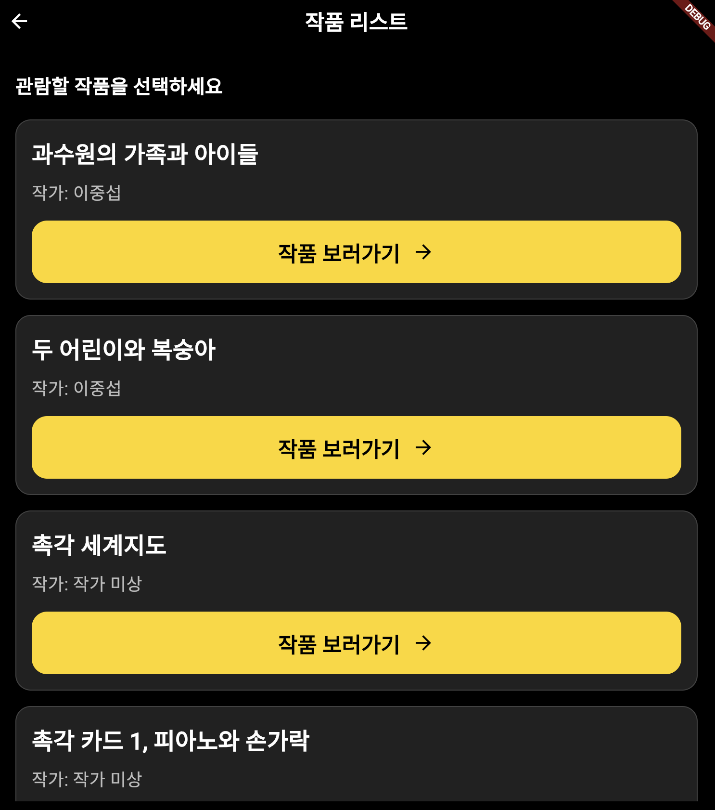
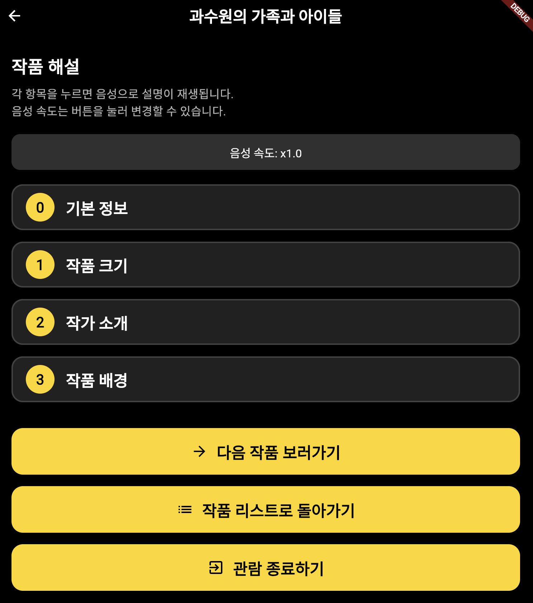

_An accessibility platform enabling visually impaired individuals to independently explore art galleries_

### Overview

Developed as part of SNU Global Social Contribution Corps, **ForAll** is a mobile platform designed to help visually impaired people navigate and experience art exhibitions **without assistance from guides**.

Our team ("모두의 편의점") was divided into three sub-teams:
- **Device Team**: Hardware development for tactile and spatial feedback
- **Program Team**: Mobile app and computer vision development
- **Planning Team**: User research and content creation

### My Contributions

As a member of the **Program (Development) Team**, I contributed to:

- **Mobile App Development**: Built the core application enabling audio descriptions and artwork information delivery
- **Location-based Services**: Implemented indoor positioning to guide users to artwork locations
- **Accessibility Features**: Designed voice-based UI optimized for screen reader compatibility

### Key Features

- **Audio Descriptions**: Detailed voice narration of artworks and exhibition spaces
- **Indoor Navigation**: Step-by-step guidance to locate artworks within the gallery
- **Tactile Support Integration**: Synchronized with physical tactile materials for enhanced understanding
- **Autonomous Exploration**: Users can explore freely without requiring human assistance

### User Study

**Pilot Study at Siloam Center for the Blind (May 27-30, 2025)**

Conducted user testing at the S Gallery with **18 visually impaired participants**:

  
  

**Key Findings:**
- Participants successfully navigated the gallery and understood artworks independently
- Audio descriptions and tactile materials significantly improved engagement and comprehension
- Users appreciated the detailed artwork explanations and location guidance features
- The platform enhanced autonomy compared to traditional guided tours

### Demo & Showcase

**SNU Global Social Contribution Showcase (June 23, 2025)**

After incorporating feedback from the pilot study, we presented the refined platform at the university showcase, demonstrating the full experience to 11 participants.

### Impact

> "A completely new way to experience exhibitions... I could understand the artworks and navigate the space without any assistance."
> 
> *— Participant feedback from user study*

This project demonstrated that with thoughtful accessibility design, visually impaired individuals can enjoy rich, independent cultural experiences that were previously only possible with human assistance.
