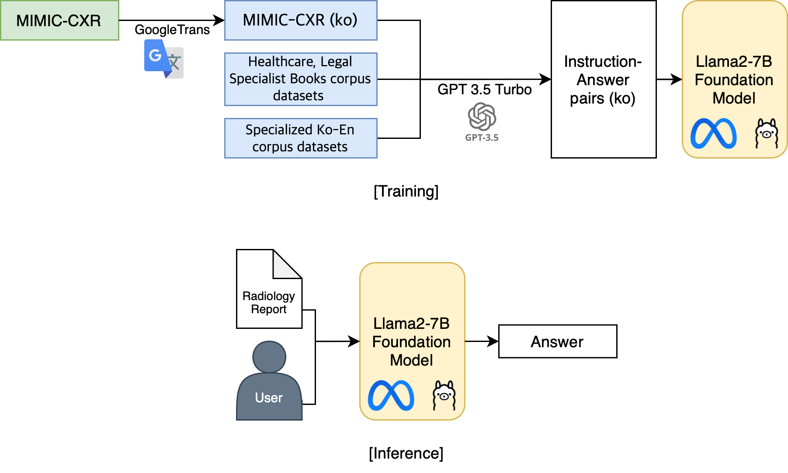
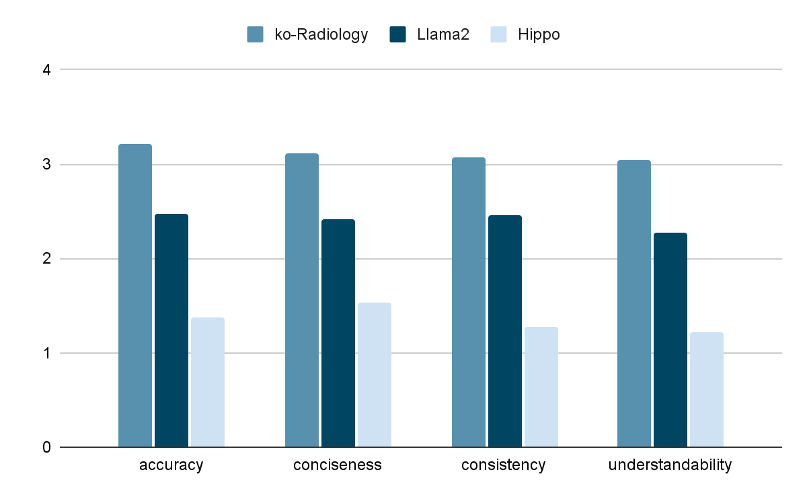
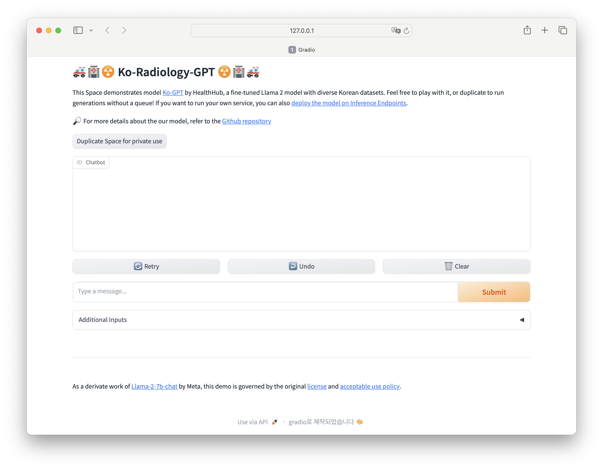

### Overview

Radiology reports are written for clinicians and are hard for patients to read, and Korean resources in this domain are scarce. **Ko-Radiology-GPT** lets non-experts ask questions about a chest X-ray report in Korean and get clear answers, supporting **summarization**, **information extraction**, **paraphrasing**, and **acronym expansion**.

### My Role

- **Data collection**: Sourced the additional Korean medical corpora from AI Hub
- **QA generation**: Built the question–answer pairs used for fine-tuning
- **Evaluation**: Co-defined the four criteria and evaluation prompts, and analyzed results against baselines
- **Demo & manual**: Built the conversational demo interface and wrote the user manual

### Approach

**Data**

- **MIMIC-CXR** reports, translated into Korean (no large Korean radiology dataset was available)
- About **4,000** radiology-related samples from **AI Hub** Korean medical corpora
- Question–answer pairs generated with **GPT-3.5-turbo** for each task, stored as JSONL

**Model**

- Fine-tuned **Llama2-7B-chat** with **LoRA** and **8-bit quantization** so training and inference fit on a single GPU (Colab A100)
- **Gradio** interface for interactive Q&A

### Results

Responses were scored (0–4) on **accuracy, conciseness, consistency, and understandability**. Ko-Radiology-GPT outperformed both the base **Llama2** and the English medical model **Hippo** on all four criteria, e.g. accuracy **3.21** vs. about 2.5 (Llama2) and 1.4 (Hippo).

  
  

