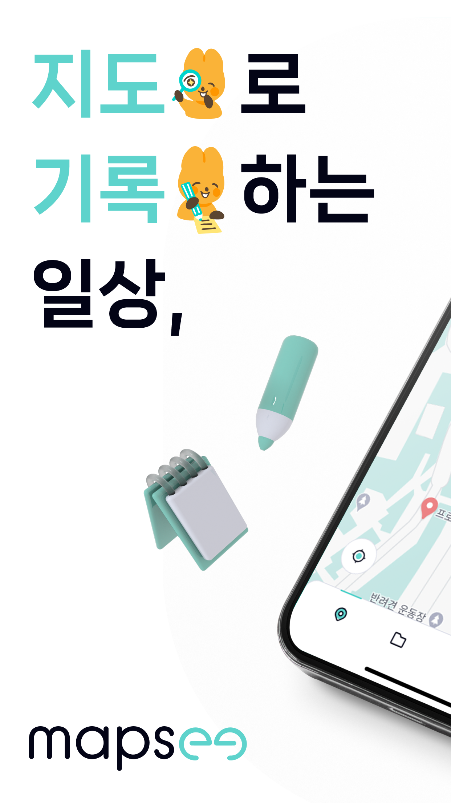
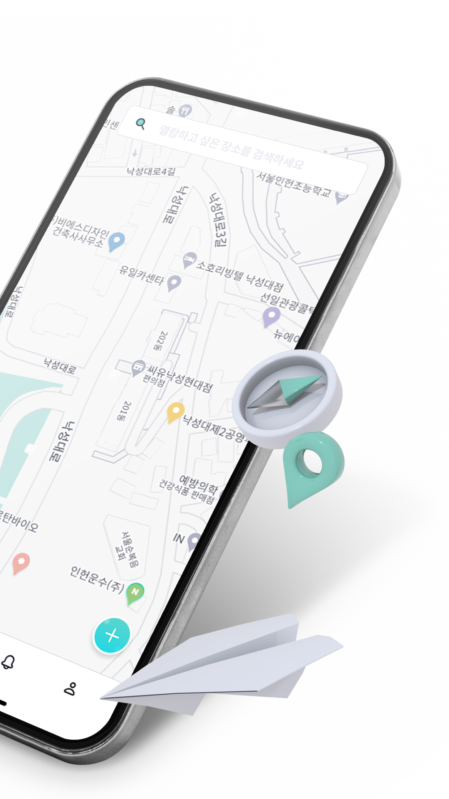
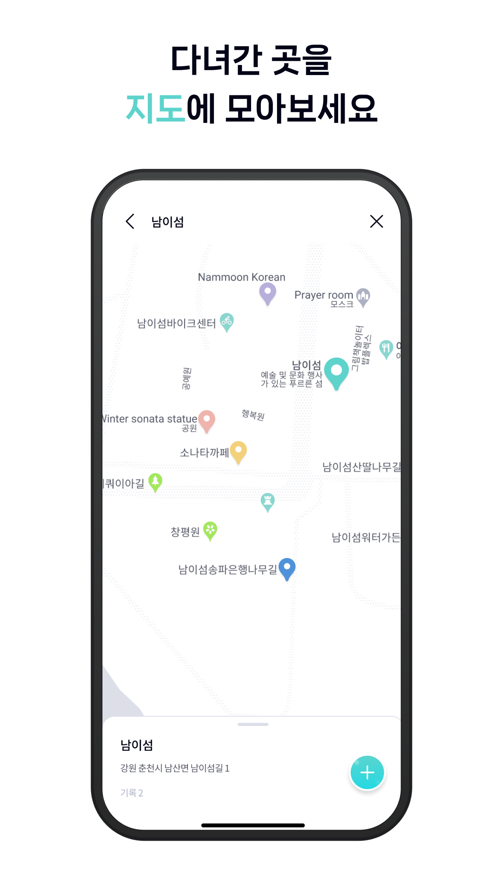

### Overview

**Mapsee** ties journal entries to places on a map. Users record memories at specific locations and share them with friends through collaborative folders.

  
  
  
  
  

### My Role

- **Map & search**: Integrated Google Maps and Autocomplete APIs for proximity-based search
- **Diary writing**: Built location-based entries with text, photos, and tags
- **Interface**: Designed the bottom-sheet search navigation, animations, and tutorials
- **Data**: Cached recent searches and preferences with async storage and handled image saving
- **App Store release**: Fixed review issues and communicated with Apple's review team through approval

### Approach

- **Map diary**: Pick a location, write the day's story, and attach photos
- **Place collections**: Save favorite restaurants and travel spots on a personal map
- **Shared folders**: Invite friends to record memories together, e.g. for group trips

### Results

Released on the **Apple App Store** (Feb 2023 – Feb 2024) after passing App Store review. Mapsee was Happetite's second product and its first map-based service.
