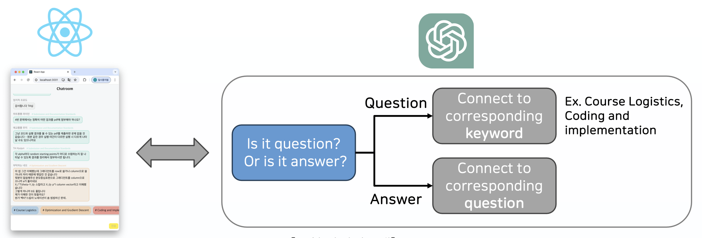
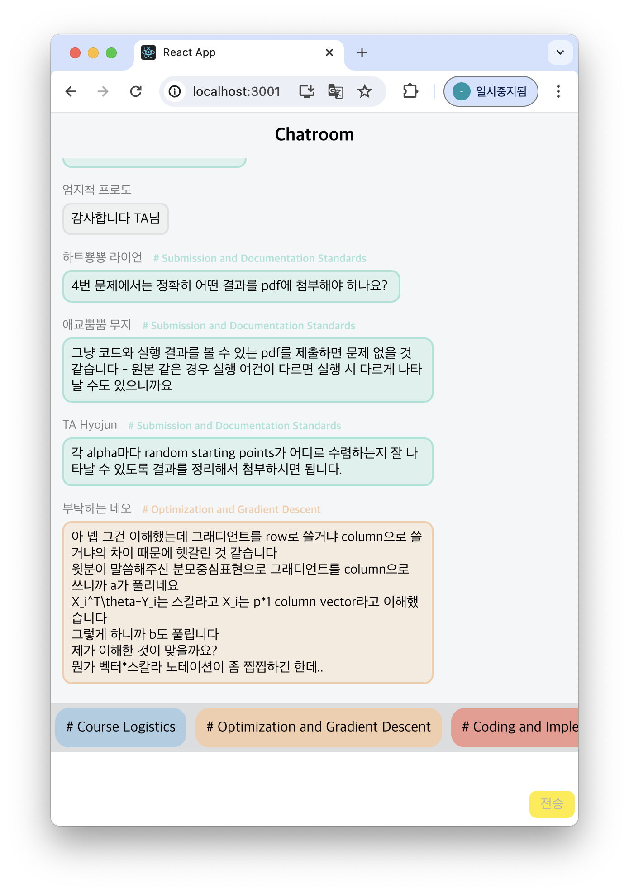
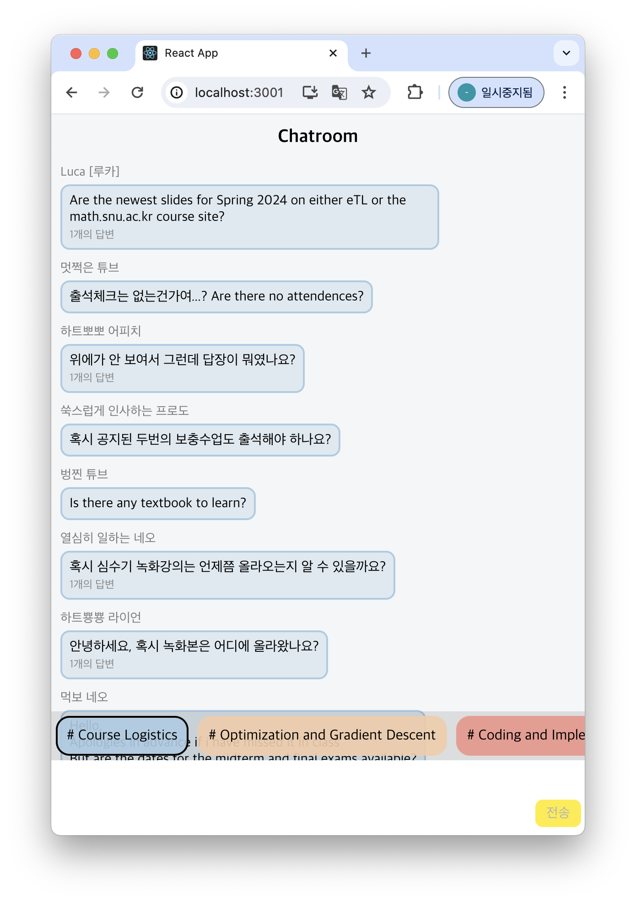
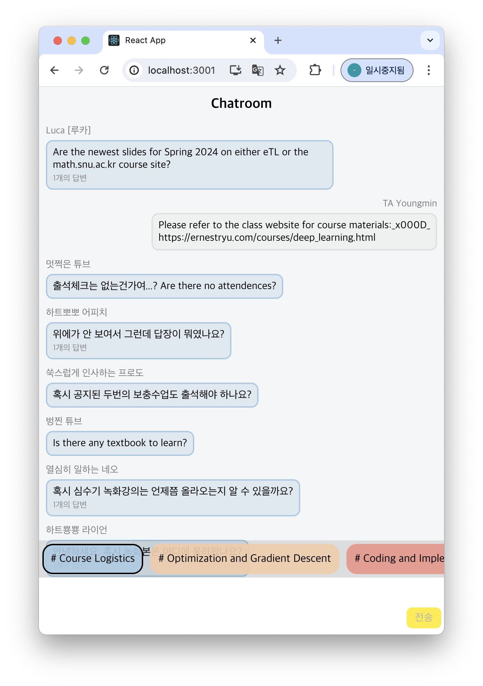

### Overview

Large group chats, such as course chat rooms with hundreds of students, suffer from two problems:

1. **Information overload**: Important answers get buried under a flood of messages.
2. **Repetitive questions**: The same questions are asked again and again, wasting the time of TAs and instructors.

QuAC automatically **classifies messages, tags them by topic, and links each answer to the question it resolves**, so earlier answers stay easy to find.

### My Role

- **Project Lead**: Defined the problem and target users (students, TAs, and instructors)
- Designed the question/answer linking pipeline and the chat interface
- Planned and ran the user study

### Approach

A **React** chat interface connected to the **GPT-4 API**:

1. **Question or answer?** Each incoming message is classified by the LLM.
2. **Questions** are tagged with a topic keyword (e.g., *Course Logistics*, *Coding and Implementation*).
3. **Answers** are connected to the question they respond to.
4. Users browse by topic tag to find earlier questions and their answers.

The interface was prototyped in Miro and iterated toward a structured Q&A layout with keyword-based navigation.

  
  
  

### Results

Qualitative user study with **8 participants**, using **think-aloud** and **constructive interaction** (pairs using the system together):

- Participants valued retrieving earlier answers through topic keywords
- Participants asked for finer-grained topic matching to cover a broader range of questions
- Complex questions highlighted the need for more accurate question–answer linking
