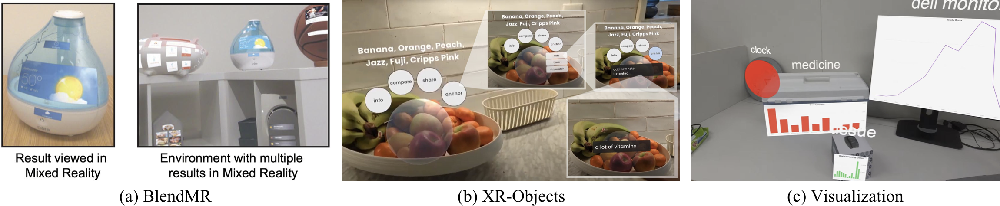
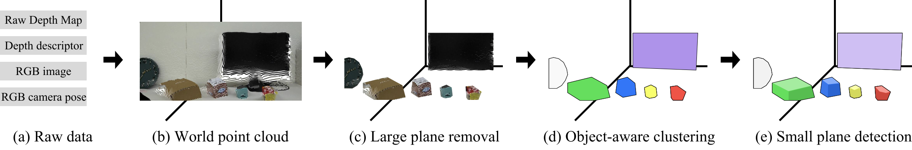
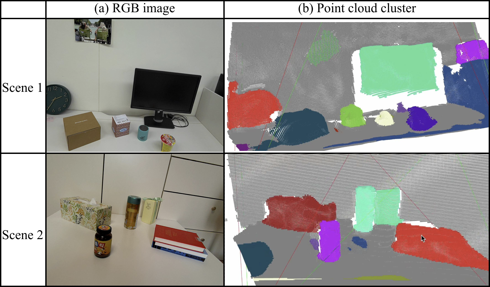
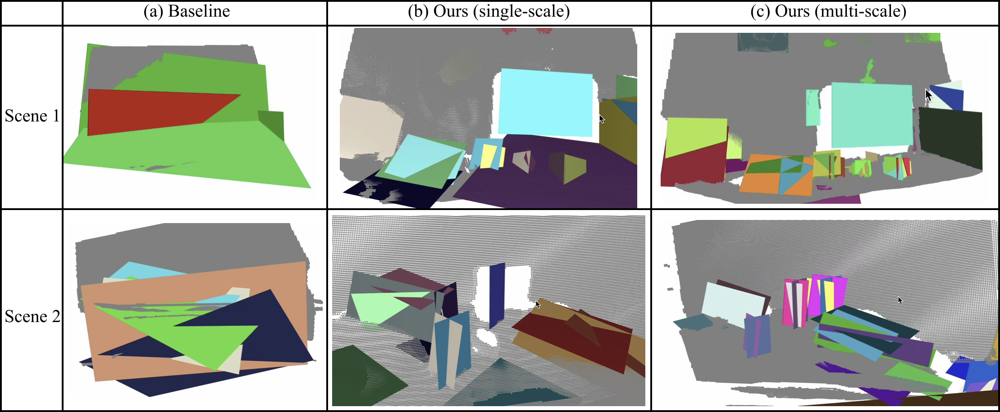

### Overview

Current AR systems rely on global RANSAC-based plane detection, which captures large surfaces (floors, walls, desks) but **misses small object-level planes** like book tops, box lids, and monitor stands.
Detecting these small surfaces matters because it lets AR **anchor content to individual objects** rather than only to rooms: a label on top of a box, a virtual widget resting on a book, or interaction feedback placed directly on the object a user is touching. This enables richer, object-centric AR experiences.

### My Role

- **Project Lead**: Defined the problem and designed the clustering-before-fitting pipeline
- Implemented the pipeline on Meta Quest 3 depth data and ran the evaluation

### Approach

**Key insight:** by isolating object-level clusters _before_ plane fitting, small planes become **locally dominant** within their clusters—making them detectable without semantics, RGB, or neural networks.

1. **Raw depth acquisition** from Meta Quest 3 stereo sensors
2. **World point cloud reconstruction**
3. **Dominant plane removal** (floors, walls, desks)
4. **Object-aware DBSCAN clustering**
5. **Per-cluster RANSAC** with multi-scale thresholds

### Results

| Method | Plane Recall (Scene 1) | Plane Recall (Scene 2) | Runtime |
|:-------|:----------------------:|:----------------------:|:-------:|
| Baseline (Global RANSAC) | ~0.14 | ~0.10 | 0.39–0.63s |
| Ours (Single-scale) | 0.71 | 0.71 | 0.54–0.99s |
| Ours (Multi-scale) | **0.79** | **0.86** | 0.75–0.92s |
{: .highlight-last}

Plane recall improves **5–8×** over the global baseline, at the cost of a modest runtime increase.

A **depth-only, geometry-only** approach can recover small-object surfaces for mobile AR without dense reconstruction or learned models, enabling richer object-centric interactions on commodity hardware.
